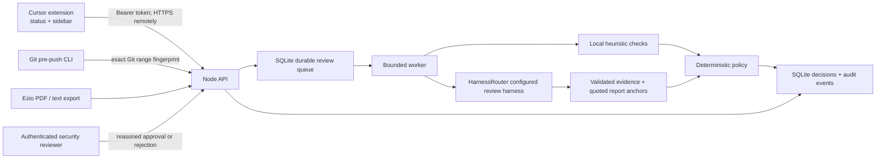

# TrustGate: end-to-end system design

Status: implementation specification, 2026-10-10. Target: Cursor desktop, single organization deployment. This document distinguishes the implemented local service from the remaining live-provider and hosted rollout work.

## Product and actors

A developer asks whether a particular Git change can ship. A security reviewer owns exceptions and evidence gaps. TrustGate answers BLOCK (low), ESCALATE (medium), or APPROVE (high), with reasons anchored to evidence. A fourth operational state, NOT VERIFIED, covers unavailable, pending, stale, or invalid results. It never grants permission.

The hackathon report workflow is independent of code approval: a user imports an Ezio report and states who relies on the answer and for what. The same policy works across nuclear energy, work from home, EV market, and AGI timelines without topic-specific branches. Synthetic fixtures are only development examples, never genuine Ezio reports or production push approvals.

## Architecture

## Frontend: Cursor extension

Use the VS Code extension API supported by Cursor. A status item opens a webview sidebar. It shows trust level, decision reasons, scope, evidence, coverage, provenance, timestamps, and next steps. Buttons run checks, import reports, and submit reviewer decisions. Webview uses a nonce CSP, textContent, no external scripts, and no credentials. API token is in editor SecretStorage, backend URL is a machine-scoped setting. No provider keys in the extension.

Default check interval: 180 seconds, configurable to 300. Run only for changed snapshots; serialize requests. Text changes immediately mark the result stale. Saved tracked working changes are preview checks; unsaved and untracked files are explicitly outside that snapshot. A separate committed-range check is required for push approval. First version supports one selected workspace folder and origin remote; unsupported cases fail visibly.

## Backend and persistence

Node 24 HTTP service with built-in SQLite (WAL, foreign keys, busy timeout), one process and bounded background concurrency. Authenticated JSON API with strict payload validation, bounded bodies, rate limits, provider timeouts, sanitized errors, and request IDs. SQLite stores jobs, immutable original decisions, reviewer events, and exact subject bindings. Restart marks interrupted work failed; no stale approval is inferred. Pending jobs resume. GET polling supplies progress. Health and readiness are distinct.

Single-organization roles: developer can create/read reviews; reviewer additionally resolves escalations. Provision separate bearer credentials from environment, compare safely, never log them. Reviewer identity is configured server-side. Production requires distinct strong tokens, TLS termination, persistent private storage, backups, restricted network access, and a configured HarnessRouter harness. Horizontal scaling and enterprise SSO are future migrations, not claims about this release.

## Evidence pipeline

1. Capture a bounded Git diff and a SHA-256 fingerprint of repo identity, base, head, scope, and exact diff.
2. Local heuristics flag obvious secret patterns and dangerous constructs. They are a limited signal, not a full SAST engine.
3. HarnessRouter reviews the diff or extracts an imported report. Its configured ID and endpoint are server-owned. Treat all source text as untrusted data; never execute repository code or generated commands.
4. Report normalization retains claim verdicts, relevance, source quality/date, four 0–5 module scores, critical findings, and coverage limitations. Each extracted claim/finding has an exact quote present in the imported report. Malformed or ungrounded output fails closed.
5. The policy evaluates the evidence, not the report's headline. Contradicted critical claims block; unverified critical claims or weak coverage escalate. Approval requires supported critical claims and adequate coverage. A display score is a policy indicator, not probability of safety.
6. Code-only heuristic/LLM checks cannot auto-approve: without a verified Ezio integration they require reviewer resolution. Imported general-purpose reports cannot be attached to arbitrary code to unlock a push.

Ezio integration boundary: the public challenge documents PDF report export, not an authenticated code-verification API. Implement PDF/text import now, preserving provenance as user-supplied. Do not label imported documents cryptographically authenticated. Live automated Ezio analysis and authoritative report-to-code binding require its actual API contract and credentials; until then this limitation is explicit in UI and readiness.

## Decision and human review

| Condition | Action |
|---|---|
| Critical contradicted claim / critical finding / local serious finding | BLOCK |
| Unsupported material claim, weak sources, low module scores, coverage gap | ESCALATE |
| Supported material claims, adequate scores and sources, complete reported coverage | APPROVE for report-use decision |
| Code check without independent verification | ESCALATE |
| Missing/failed/stale review | NOT VERIFIED; deny gate |

Reviewer can approve or reject an escalation with a substantive reason; cannot override a hard block. This records an explicit risk acceptance, not a fabricated higher evidence score. Decisions bind to fingerprint and expire after 15 minutes. Human approval does not turn medium evidence confidence into high confidence. The gate checks the effective action and expiry; UI shows both confidence and human disposition. New evidence requires a new review.

## Git enforcement

CLI receives each pre-push ref update on stdin, resolves the exact local/remote object IDs, computes the same fingerprint, and asks the service for approval. All updates must pass. Deletes, tags, missing objects, unknown repositories, network failures, malformed responses and absent approvals fail closed in v1. New branches use the empty tree as base and review all content. No reliance on current HEAD for a multi-ref push. Hook installer refuses to overwrite an existing pre-push hook or custom hooksPath.

A client hook can be bypassed by its owner; it is a local guard, not organizational enforcement. A required GitHub check should run the same CLI against a protected base/head using a service-owned credential. Repository rule configuration and live GitHub installation remain rollout tasks requiring a target repository. Never give untrusted PR code a reviewer token.

## API

- GET /healthz, /readyz: operational status, no secrets.
- POST /v1/reviews: code snapshot or report text with decision context; returns 202 + job ID.
- GET /v1/reviews/:id: job, evidence, reasons, effective action.
- POST /v1/reviews/:id/resolve: reviewer-only approval/rejection with reason.
- POST /v1/gate: fingerprint lookup; only current completed code approvals pass.
- GET /v1/audit: reviewer-only recent metadata events.

PDF extraction happens locally with Python and pypdf before submission. Backend accepts bounded plain text; it never invokes a PDF or shell parser on a remote payload.

## Deployment and validation

Deliver a self-contained Node service, Cursor VSIX, CLI, Dockerfile/Compose, environment example, tests, and operations runbook. Local run exercises real HTTP, SQLite, auth/roles, worker lifecycle, decision branches, stale binding, exact Git ranges, multi-ref rejection, and provider failures. Provider tests use explicitly labeled mock HTTP services until live keys exist. Test report fixtures must never masquerade as the four real reports. Production launch requires actual Ezio reports, live HarnessRouter run, Cursor host smoke test, TLS/host configuration, backup restore drill, and a protected GitHub enforcement check.

## References

- https://github.com/ezioai/Build-Trust-Agent/blob/main/buildathon_challenge.md
- https://www.harnessrouter.ai/docs/run-a-task
- https://www.harnessrouter.ai/docs/base-url
- https://www.harnessrouter.ai/docs/authentication
- https://code.visualstudio.com/api/extension-guides/webview
